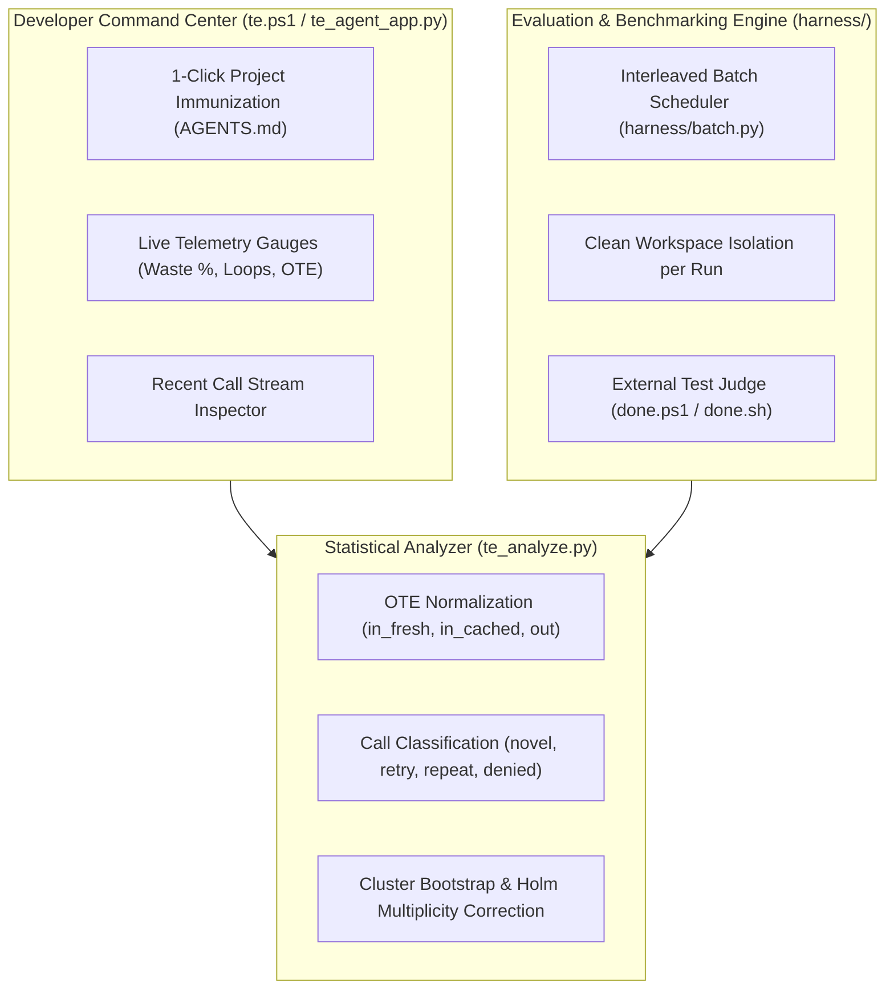

# TE-Agent: Token Economics & Evaluation Harness for Coding Agents

**A measurement-first system that replaces prompt bloat with lean, contract-based configurations — reducing cost per solved task, eliminating command thrashing, and preventing false completion claims.**

---

## 1. Why TE-Agent?

Standard coding assistant conventions (such as `/init` in OpenCode, Cursor, and Claude Code) generate 300–600 lines of markdown instructions detailing directory trees, style guides, and generic platitudes. 

Because this text is resident in the context window across every turn, it causes three major failure modes:
1. **Resident Context Tax**: Consumes 6,000–15,000+ unnecessary input tokens per session.
2. **Attention Dilution**: Finite model self-attention is distracted by boilerplate instead of your actual prompt, test logs, and code diffs.
3. **Unbounded Tool Waste**: Agents re-read unchanged 500-line files multiple times, retry failing terminal commands in loops, and claim tasks are "done" when tests are still failing.

**TE-Agent replaces unmeasured conventions with an empirical, statistically verified contract.**

---

## 2. Quick Start

TE-Agent requires **zero external dependencies** (pure Python standard library).

### Launch the Interactive Web Dashboard

Open the live dark-mode command center in your browser:
```powershell
.\te ui
```
*Access the dashboard at `http://localhost:8844` with real-time waste gauges, live telemetry call streams, and 1-click project immunization.*

### Instant Session Audit

Audit token efficiency and loop incidents on your active session with automatic transcript discovery:
```powershell
.\te audit
```

### Immunize Any New Project

Deploy the lean, token-economic contract into any new repository:
```powershell
# OpenCode / Antigravity (creates AGENTS.md)
.\te init -Platform opencode

# Cursor (creates .cursorrules)
.\te init -Platform cursor

# Claude Code (creates CLAUDE.md)
.\te init -Platform claude
```

---

## 3. Core Architecture



---

## 4. The 5 Core Operating Invariants

When `AGENTS.md` is installed in a repository, the agent operates under five strict invariants:

| Rule | Mechanism | Intervention Tested |
| :--- | :--- | :--- |
| **1. Pre-Call Intent** | Must declare a 1-line hypothesis before running commands or editing files. | Eliminates aimless trial-and-error commands; grounds model attention. |
| **2. Anti-Repeat Cache** | Prohibits re-reading files read within the last 3 turns; reuses conversation context. | Stops the single biggest token leak: redundant re-reading of unchanged files. |
| **3. Range-Targeted Reads** | Mandates reading targeted line ranges (`StartLine`/`EndLine`) for functions/symbols. | Prevents dumping 500+ lines into context repeatedly. |
| **4. Two-Strike Stop Rule** | If a command fails twice with similar arguments, immediately halts the loop. | Eliminates infinite retry loops; triggers strategy re-evaluation. |
| **5. External Verification** | Never self-adjudicate success. Completion requires external judge checks (`done.ps1`). | Eliminates false completion claims ("overclaims"). |

---

## 5. Scientific Measurement Harness & Analyzer

TE-Agent includes a complete empirical testing laboratory adhering to `01-METRICS-SPEC.md v0.1`:

- **Normalized Output-Token-Equivalents (OTE)**:
  $$\text{OTE} = w_{\text{fresh}} \cdot \text{in\_fresh} + w_{\text{cache}} \cdot \text{in\_cached} + 1.0 \cdot \text{out}$$
- **Algorithmic Call Classification**:
  Compares tool call arguments via token-set Jaccard similarity ($\text{thr} = 0.85$) into `novel`, `retry`, `repeat`, and `denied`.
- **A/A Calibration Gate**:
  Ensures that the harness has zero artificial noise floor ($\text{CV} \le 0.25$, paired $p = 1.000$) before testing candidate interventions.
- **Cluster Bootstrap & Holm Multiplicity Correction**:
  Resamples at the task level over 10,000 iterations to yield defensible $95\%$ confidence intervals and Holm-adjusted $p$-values.

---

## 6. Project Directory Layout

```
opencode-setup/
├── te.ps1                       # 1-word CLI launcher (ui, audit, init)
├── prices.json                  # Versioned provider pricing table (w_fresh, w_cache, out)
├── te_analyze.py                # Pure Python statistical analyzer & decision rule
├── AGENTS.md                    # Active token-economic contract for this workspace
├── GEMINI.md                    # Core project mission & operating guidelines
├── README.md                    # Master project documentation
│
├── tools/
│   ├── te_agent_app.py          # Unified Command Center & Web Dashboard server
│   ├── audit_session.py         # Standalone transcript audit utility
│   └── te_init.py               # Config generator CLI
│
├── harness/
│   ├── run.py                   # Single headless run manager (writes manifest, events, done)
│   └── batch.py                 # Interleaved multi-task, multi-seed batch scheduler
│
├── tasks/                       # Benchmark Task Corpus
│   ├── T01/                     # Single-file bug fix (calculator.py) + done.ps1
│   ├── T02/                     # Multi-file interface refactor (User email) + done.ps1
│   └── T03/                     # Misleading trace / subtle bug (LRU cache) + done.ps1
│
└── configs/                     # Ablation Configuration Arms
    ├── C0a / C0b                # Byte-identical baseline configs (A/A test)
    ├── C1                       # Invariants + 1-line intent hypothesis
    ├── C2                       # C1 + Negative tool cards & smart range reads
    └── C3                       # C2 + Strict turn ceilings & 2-strike stop rules
```

---

## 7. License & Credits

Built as part of **Project TE-Agent (Token Economics for Coding Agents)**. Pure Python stdlib, designed for OpenCode and Antigravity.
